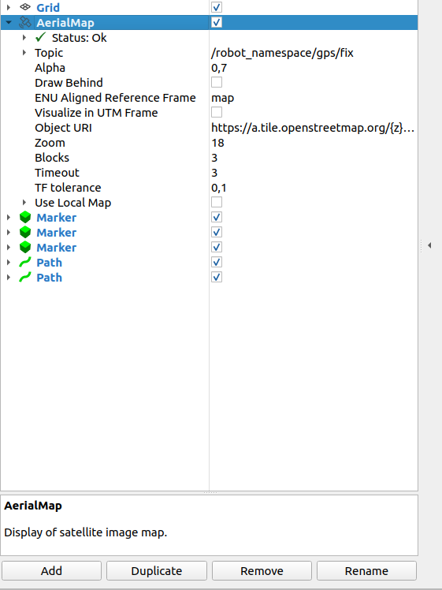
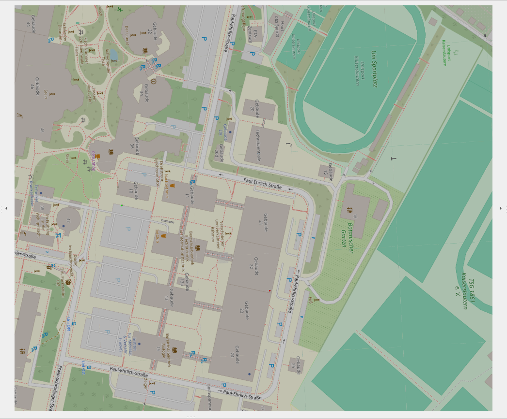
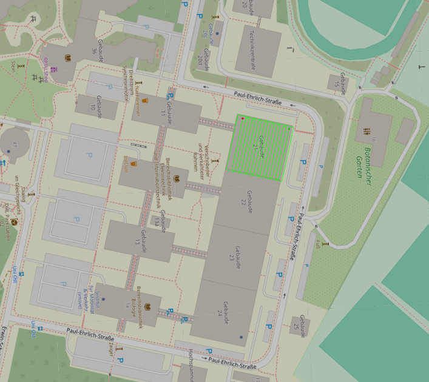
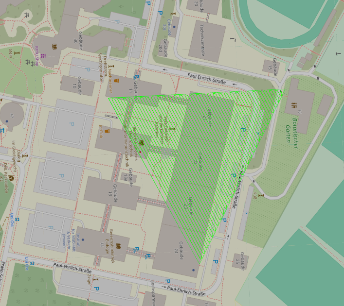
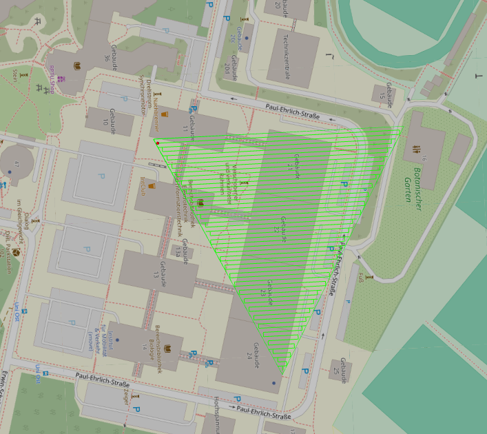
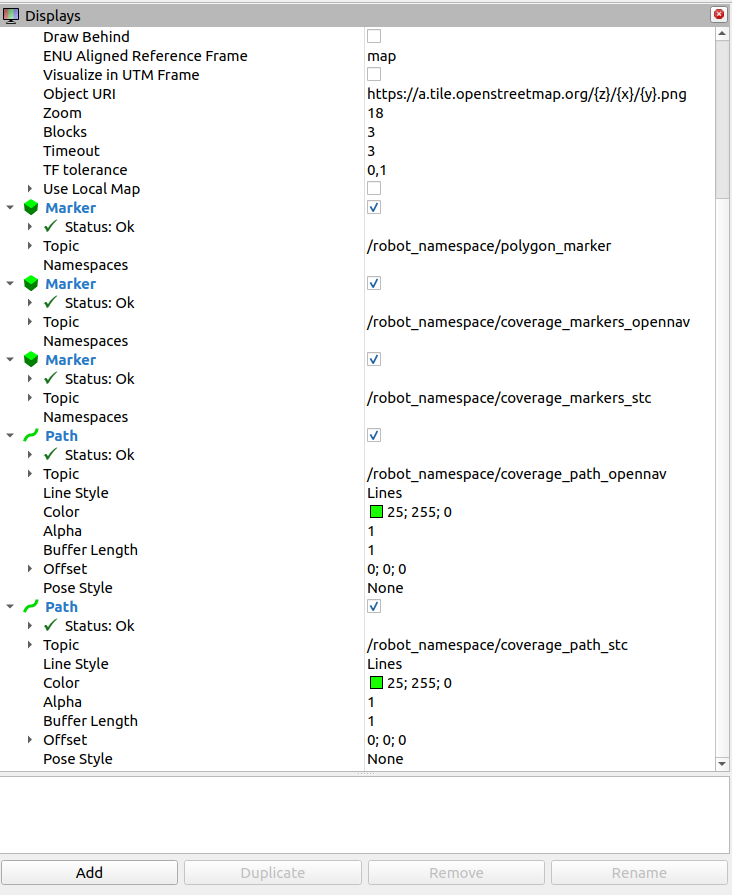

# ROS 2 UAV Coverage Path Planner

A ROS 2-based framework for generating and visualizing coverage paths for unmanned aerial vehicles (UAVs) operating within user-defined polygonal areas.

This project implements and compares two coverage-planning approaches:

- **OpenNav Coverage:** A coverage-planning solution based on the OpenNav Coverage framework and Fields2Cover.
- **Custom STC-Inspired Planner:** A grid-based planner that constructs a spanning tree using depth-first search (DFS) and generates a traversal path through the cells inside a polygonal workspace.

The framework provides an RViz2-based workflow for defining a coverage area, generating paths using both planners, and comparing their outputs.

## Table of Contents

- [Features](#features)
- [Demonstration](#demonstration)
- [System Architecture](#system-architecture)
- [Planning Workflow](#planning-workflow)
- [Technologies and Dependencies](#technologies-and-dependencies)
- [Installation](#installation)
- [Building the Workspace](#building-the-workspace)
- [Running the Framework](#running-the-framework)
- [ROS 2 Nodes](#ros-2-nodes)
- [ROS 2 Topics](#ros-2-topics)
- [Custom STC-Inspired Planner](#custom-stc-inspired-planner)
- [Resetting the Planning Process](#resetting-the-planning-process)
- [Current Limitations](#current-limitations)
- [Future Improvements](#future-improvements)
- [License](#license)
- [Acknowledgements](#acknowledgements)

---

## Features

- **Interactive polygon definition:** Define a coverage workspace through RViz2.
- **Multiple coverage planners:** Generate coverage paths using OpenNav Coverage and a custom STC-inspired algorithm.
- **Polygon-based workspace:** Plan paths for two-dimensional polygonal areas.
- **Grid-based traversal:** Represent the workspace as a grid and construct a traversal route through cells inside the polygon.
- **Spanning-tree-based planning:** Use depth-first search to construct and traverse a spanning tree in the custom planner.
- **Path visualization:** Display generated paths and associated markers in RViz2.
- **Multiple workspace geometries:** Demonstrate and compare planner outputs for square and triangular workspaces.
- **Reset functionality:** Reset the planning process to define another workspace and generate new paths.

## Demonstration

The following screenshots illustrate the map visualization, workspace definition, and coverage paths generated by the two planners.

### 1. Aerial Map Panel

The aerial-map panel provides a map visualization that can be used as a reference when defining the coverage workspace.



### 2. Map Visualization Before Polygon Definition

This screenshot shows the map visualization before the polygon vertices have been selected.



### 3. Square Workspace

The following screenshots show the paths generated by the two planners for a square workspace.

**OpenNav Coverage**



**Custom STC-Inspired Planner**


### 4. Triangular Workspace

The planners can also be evaluated using a triangular workspace, demonstrating their application to a different polygonal geometry.

**OpenNav Coverage**



**Custom STC-Inspired Planner**



### 5. Coverage Paths and Markers

This screenshot provides an additional view of the generated paths and their visualization markers.



These examples demonstrate the framework's polygon-based planning workflow and provide a visual comparison of the two planning approaches.

The screenshots represent planning and visualization results. They do not constitute validation of autonomous UAV flight.

## System Architecture

The framework consists of three primary ROS 2 nodes and an RViz2 visualization interface.

```text
                  User Interaction
                         |
                         v
                RViz2 / Map Interface
                         |
                         v
               gps_polygon_collector
                         |
                         v
                  Polygon Workspace
                         |
                         v
                  coverage_client
                    /         \
                   /           \
                  v             v
         OpenNav Coverage   Custom STC-Inspired
              Planner           Planner
                  |                 |
                  v                 v
       coverage_path_       coverage_path_
          opennav                stc
                  |                 |
                  +--------+--------+
                           |
                           v
                 RViz2 Visualization
```

### Main Components

**`gps_polygon_collector`**

Collects user-defined polygon vertices and constructs the polygonal coverage workspace.

**`coverage_client`**

Coordinates the OpenNav Coverage planning workflow and requests coverage-path generation.

**`stc_coverage_planner`**

Implements the custom grid-based, STC-inspired coverage-planning approach and generates a traversal path for the polygonal workspace.

**RViz2**

Provides the visualization interface for workspace definition, generated paths, and associated markers.

The exact communication between components depends on the configured ROS 2 topics, services, and launch setup.

## Planning Workflow

The general planning workflow is as follows:

1. **Initialize the ROS 2 environment:** Start the required nodes and RViz2 visualization.
2. **Visualize the map:** Display the map and its reference frame in RViz2.
3. **Define the coverage area:** Mark the vertices of a two-dimensional polygon to specify the workspace.
4. **Construct the polygon:** Collect the selected vertices and prepare the polygon for planning.
5. **Generate coverage paths:** Run the available planning approaches to generate paths for the defined workspace.
6. **Visualize the results:** Display the generated paths and associated markers in RViz2.
7. **Compare the planners:** Examine the outputs produced by OpenNav Coverage and the custom STC-inspired planner.
8. **Reset or repeat:** Reset the process when a new workspace needs to be defined.

See the [Demonstration](#demonstration) section for example visualizations of the workflow and planner outputs.

## Technologies and Dependencies

| Technology | Purpose |
|---|---|
| Ubuntu 22.04 | Operating system |
| ROS 2 Humble | Robotics middleware |
| C++ | ROS 2 components and custom planning implementation where applicable |
| Python | ROS 2 nodes and planning workflow components where applicable |
| RViz2 | Workspace and path visualization |
| OpenNav Coverage | Coverage-planning framework |
| Fields2Cover | Coverage-path-planning library used by the OpenNav workflow |
| colcon | ROS 2 workspace build tool |
| rosdep | Dependency installation for ROS packages |

The exact dependencies and versions should match the package manifests and build configuration in the repository.

## Installation

### 1. Install ROS 2 Humble

Install ROS 2 Humble on Ubuntu 22.04 by following the official instructions:

https://docs.ros.org/en/humble/Installation/Ubuntu-Install-Debs.html

Source the ROS 2 environment:

```bash
source /opt/ros/humble/setup.bash
```

To source ROS 2 automatically in new Bash terminals, you can add the command to `~/.bashrc`:

```bash
echo "source /opt/ros/humble/setup.bash" >> ~/.bashrc
```

If this line is already present in your `~/.bashrc`, do not add it again.

### 2. Install Development Tools

Install the basic tools required for building and managing a ROS 2 workspace:

```bash
sudo apt update
sudo apt install -y \
    git \
    python3-pip \
    python3-colcon-common-extensions \
    python3-rosdep
```

If `rosdep` has not been initialized on your system, initialize it according to the official ROS 2 documentation.

### 3. Clone the Repository

Clone the repository:

```bash
git clone https://github.com/hrishikeshdudhe/ros2-uav-coverage-planner.git
```

Navigate to the repository:

```bash
cd ros2-uav-coverage-planner
```

**Note:** This repository URL assumes that the project is publicly available under this address. If the repository name or visibility changes, update the URL accordingly.

### 4. Install Project Dependencies

This project uses ROS 2 packages and coverage-planning libraries. Their availability depends on the package manifests and the installation method used for OpenNav Coverage and Fields2Cover.

From the root of the ROS 2 workspace, run:

```bash
rosdep install --from-paths src --ignore-src -r -y
```

This command attempts to install dependencies declared in the ROS package manifests.

If OpenNav Coverage or Fields2Cover is not available through your configured package sources, install the required versions using their official documentation and ensure they are compatible with ROS 2 Humble.

- [OpenNav Coverage](https://github.com/open-navigation/opennav_coverage)
- [Fields2Cover](https://github.com/Fields2Cover/Fields2Cover)

The actual dependencies required by the project should be verified against its `package.xml` files and build configuration.

## Building the Workspace

The project is intended to be built in a ROS 2 workspace using `colcon`.

If the repository is located inside the `src` directory of an existing workspace, navigate to that workspace's root directory.

For example:

```bash
cd ~/clean_nav_ws
```

Source ROS 2 Humble:

```bash
source /opt/ros/humble/setup.bash
```

Install dependencies if you have not already done so:

```bash
rosdep install --from-paths src --ignore-src -r -y
```

Build the package:

```bash
colcon build --packages-select gps_anchor
```

Source the resulting workspace:

```bash
source install/setup.bash
```

If the build fails, check the terminal output for missing dependencies, package-name mismatches, or errors in the C++ and Python components.

**Important:** The commands in this README assume that the ROS 2 package is named `gps_anchor`. If the name in `package.xml` differs, replace `gps_anchor` with the actual package name.

## Running the Framework

After building the workspace, source both ROS 2 and the local workspace:

```bash
source /opt/ros/humble/setup.bash
source ~/clean_nav_ws/install/setup.bash
```

### Launch the Coverage Planning Interface

The following launch command is used to start the RViz2 coverage-planning interface:

```bash
ros2 launch gps_anchor rviz_coverage_launch.py
```

### Launch the Offline Visualization

An offline visualization launch file is also available in the development setup:

```bash
ros2 launch gps_anchor rviz_coverage_offline_launch.py
```

The offline launch configuration is intended for visualization and development without relying on a live GPS receiver.

**Note:** These commands assume that the launch files are included in the installed `gps_anchor` package. Confirm their names and availability in the repository before using them on a fresh installation.

### Define and Plan a Coverage Area

Once the interface is running:

1. Inspect the map and coordinate reference displayed in RViz2.
2. Select the points that define the desired polygonal workspace.
3. Complete the polygon definition using the configured interaction workflow.
4. Trigger or wait for the configured coverage-planning requests.
5. Inspect the generated paths and visualization markers.
6. Compare the results from the OpenNav and custom STC-inspired planners.

The available controls and exact sequence depend on the configured RViz2 tools, ROS 2 nodes, and launch file.

## ROS 2 Nodes

### `gps_polygon_collector`

**Purpose:** Collects the polygon vertices selected by the user.

Responsibilities include:

- Receiving user input through the configured ROS 2 interface.
- Collecting polygon vertices.
- Constructing the polygon representation.
- Publishing the collected polygon for downstream planning components.

### `coverage_client`

**Purpose:** Coordinates the OpenNav Coverage planning workflow.

Responsibilities include:

- Receiving or accessing the defined coverage workspace.
- Requesting coverage-path generation through the OpenNav Coverage interface.
- Making the generated path available for visualization.

### `stc_coverage_planner`

**Purpose:** Generates a coverage traversal path using a custom grid-based, STC-inspired algorithm.

Responsibilities include:

- Representing the polygonal workspace using a grid.
- Identifying cells that belong to the workspace.
- Constructing a spanning tree through the traversable cells.
- Traversing the tree to generate an ordered path.
- Calculating waypoint headings where implemented.
- Publishing the resulting path and visualization markers.

The exact behavior of each node is determined by its implementation in the source code.

## ROS 2 Topics

The following topics are associated with the framework's planning and visualization workflow.

| Topic | Purpose |
|---|---|
| `/clicked_point` | Provides point-selection input when configured for the RViz2 interaction workflow. |
| `/collected_polygon` | Carries the collected polygonal workspace. |
| `/polygon_ready` | Indicates that the polygon is ready for downstream processing. |
| `/coverage_reset` | Triggers or communicates a reset of the coverage workflow. |
| `/coverage_path_opennav` | Carries the generated OpenNav coverage path. |
| `/coverage_path_stc` | Carries the path generated by the custom STC-inspired planner. |
| `/coverage_markers_opennav` | Provides visualization markers associated with the OpenNav result. |
| `/coverage_markers_stc` | Provides visualization markers associated with the custom planner result. |
| `/polygon_marker` | Provides a visualization marker for the polygonal workspace. |
| `/gps/fix` | Provides GPS-fix input when the corresponding input source is configured. |

To inspect the topics available in a running system, use:

```bash
ros2 topic list
```

To inspect the message type and publisher/subscriber information for a topic, use:

```bash
ros2 topic info /coverage_path_opennav
```

To inspect messages being published on a topic, use:

```bash
ros2 topic echo /coverage_path_opennav
```

The exact topic types, message rates, and publication behavior depend on the source implementation and runtime configuration.

## Custom STC-Inspired Planner

The project includes a custom grid-based planner inspired by Spanning Tree Coverage (STC) approaches.

The planner converts the coverage workspace into a discrete representation and generates a traversal path through cells contained within the polygon.

### General Algorithm

The custom planning process consists of the following conceptual stages:

1. **Grid generation:** Represent the workspace using a grid with a configured spatial resolution.
2. **Workspace filtering:** Identify the grid cells that lie inside the polygonal coverage area.
3. **Graph construction:** Represent the valid cells and their connectivity as a graph.
4. **Spanning-tree generation:** Use depth-first search (DFS) to construct a spanning tree over the reachable cells.
5. **Tree traversal:** Traverse the tree, including backtracking where required, to generate an ordered sequence of waypoints.
6. **Waypoint orientation:** Calculate waypoint headings where supported by the implementation.
7. **Path publication:** Publish the generated path and its visualization markers through ROS 2.

### Grid Resolution

The grid resolution determines the spatial granularity of the workspace representation.

A finer grid can represent the polygon boundary more closely, but it also increases the number of cells and the computational work required to construct and traverse the graph.

A coarser grid reduces the number of cells but can produce a less detailed representation of the workspace.

The chosen resolution should therefore be considered when interpreting and comparing the generated paths.

### Relationship to Classical STC

The custom implementation is **STC-inspired**. It uses grid-based graph construction, spanning-tree generation, and DFS-based traversal to create a coverage route.

It should not be interpreted as a complete implementation of every classical STC formulation or as a guarantee of optimal coverage under all workspace geometries.

The resulting path should be evaluated against the planner's assumptions, workspace representation, and intended operating conditions.

## Resetting the Planning Process

The framework includes a reset mechanism associated with the `/coverage_reset` topic.

The reset workflow can be used to clear the current planning state and begin defining another coverage workspace.

The exact reset behavior depends on how the nodes handle the reset request. Depending on the implementation, this may include clearing collected polygon points, resetting planner state, and updating the visualization.

Before starting another planning run, verify that the previous polygon and path data have been cleared as intended.

## Current Limitations

The current implementation has the following scope and limitations:

- **Two-dimensional workspaces:** The planner operates on polygonal areas represented in two dimensions.
- **Polygon-based coverage:** The coverage area is defined by user-selected polygon vertices.
- **No dynamic obstacle avoidance:** The framework does not provide a complete dynamic obstacle-detection and avoidance system.
- **No dynamic replanning:** The current workflow does not implement autonomous replanning in response to moving obstacles or changing environmental conditions.
- **Planning and visualization focus:** The project generates and visualizes coverage paths; this does not demonstrate that a UAV can execute those paths safely.
- **No flight-controller integration:** Integration with ArduPilot or another flight controller is not implemented as part of this project.
- **No autonomous-flight validation:** The displayed paths are planning outputs and should not be interpreted as evidence of successful autonomous flight.
- **Planner-specific behavior:** Differences between OpenNav Coverage and the custom planner may arise from their underlying algorithms, grid representations, boundary handling, and configuration.

These limitations define the current scope of the project and provide a basis for future development.

## Future Improvements

Potential directions for further development include:

- Improving polygon-boundary handling and workspace discretization.
- Evaluating path completeness and coverage performance using quantitative metrics.
- Comparing path length, waypoint count, computational time, and coverage efficiency.
- Testing the planners with additional polygonal workspace geometries.
- Improving visualization of cells, graph connectivity, spanning trees, and traversal order.
- Adding automated test cases for polygon processing and path generation.
- Introducing obstacle-aware planning and collision checking.
- Investigating replanning strategies for changing environments.
- Improving the interface for configuring planner parameters.
- Exploring integration with a UAV simulator and, separately, a flight-control stack after the necessary safety and validation work.

These are possible extensions, not features claimed to be implemented in the current version.

## License

A license has not been specified in this README.

Before publishing the repository, select and add an appropriate license if you have the right to distribute all included code. Review any university, supervisor, third-party, or employer restrictions that may apply to the project.

If the project contains code or dependencies derived from other repositories, preserve the relevant copyright notices and comply with their licenses.

## Acknowledgements

This project builds on the ROS 2 ecosystem and coverage-planning tools, including:

- [ROS 2 Humble](https://docs.ros.org/en/humble/)
- [RViz2](https://github.com/ros2/rviz)
- [OpenNav Coverage](https://github.com/open-navigation/opennav_coverage)
- [Fields2Cover](https://github.com/Fields2Cover/Fields2Cover)

Refer to the respective projects for their documentation, licenses, and installation instructions.
